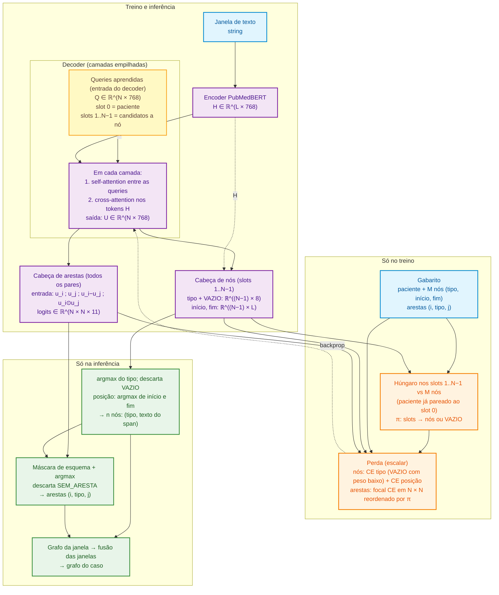

# Pipeline v1: texto clínico → grafo (one-shot)

| Símbolo | Significado | Valor sugerido |
|---|---|---|
| L | tokens da janela | ~30 a 80 (uma frase) |
| N | slots por janela (1 paciente + N−1 candidatos) | ~16 |
| M | nós reais no gabarito da janela (sem o paciente) | varia, M ≤ N−1 |
| 8 | 7 tipos de nó (DISEASE, SYMPTOM, DRUG, EXAM, ANATOMY, EFFECT, RESULT) + VAZIO | fixo |
| 11 | 10 tipos de aresta + SEM_ARESTA | fixo |

O paciente é o slot 0: existe sempre, não passa pela cabeça de nós nem pelo Húngaro, e suas arestas
(`DIAGNOSED_WITH`, `PERSONAL_HISTORY`, `FAMILY_HISTORY`, `HAS_SYMPTOM`, `TAKES`, `UNDERGOES`)
saem do mesmo tensor de arestas que as demais (`OCCURS_IN`, `AFFECTS`, `REVEALS`, `HAS_EFFECT`).
A probabilidade de um slot ser um nó é 1 − P(VAZIO); a perda de tipo dá menos peso à classe VAZIO
(no DETR, 0,1), e a perda de posição só vale nos slots pareados com um nó real.