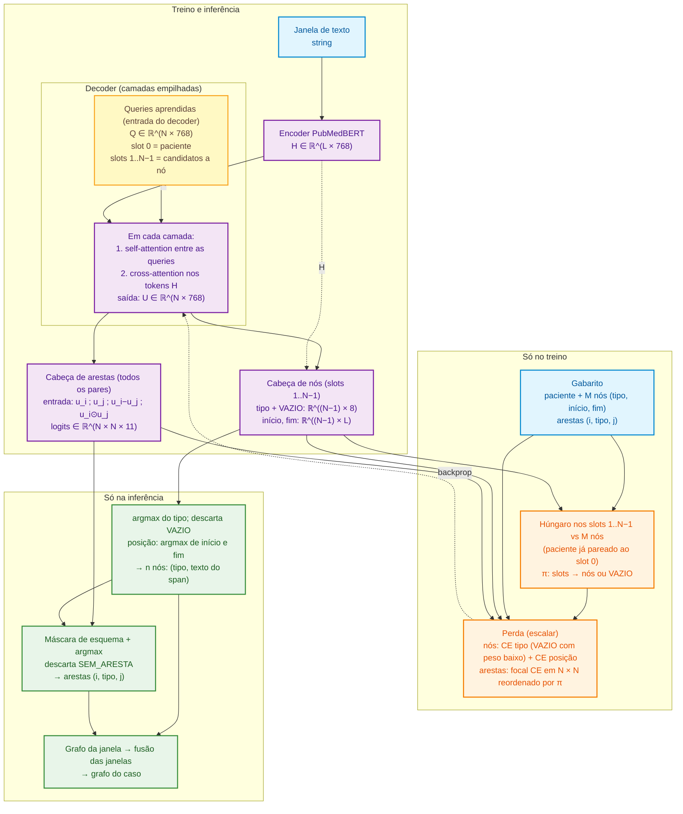

# Pipeline v1: texto clínico → grafo (one-shot)

| Símbolo | Significado | Valor sugerido |
|---|---|---|
| L | tokens da janela | ~30 a 80 (uma frase) |
| N | slots por janela (1 paciente + N−1 candidatos) | ~16 |
| M | nós reais no gabarito da janela (sem o paciente) | varia, M ≤ N−1 |
| 8 | 7 tipos de nó (DISEASE, SYMPTOM, DRUG, EXAM, ANATOMY, EFFECT, RESULT) + VAZIO | fixo |
| 11 | 10 tipos de aresta + SEM_ARESTA | fixo |

O paciente é o slot 0: existe sempre, não passa pela cabeça de nós nem pelo Húngaro, e suas arestas
(`DIAGNOSED_WITH`, `PERSONAL_HISTORY`, `FAMILY_HISTORY`, `HAS_SYMPTOM`, `TAKES`, `UNDERGOES`)
saem do mesmo tensor de arestas que as demais (`OCCURS_IN`, `AFFECTS`, `REVEALS`, `HAS_EFFECT`).
A probabilidade de um slot ser um nó é 1 − P(VAZIO); a perda de tipo dá menos peso à classe VAZIO
(no DETR, 0,1), e a perda de posição só vale nos slots pareados com um nó real.

-----------------------------------------------------------------------------------

# Hiperparâmetros do seq2matrix

As chaves são os nomes sugeridos para o arquivo de configuração (YAML). Cada experimento é um YAML
que muda uma ou poucas chaves em relação ao padrão.

**Papel:**
**A** = ablação (variamos para o relatório) ·
**T** = ajuste (busca pequena na validação) ·
**F** = fixo (usamos o padrão e não variamos) ·
**E** = definido pelas estatísticas dos dados (percentis calculados no treino)

## Dados

| Chave | Padrão | Valores a testar | Papel | Descrição |
|---|---|---|---|---|
| `window_lines` | 1 | 1, 2, 3 | A | Linhas do `.txt` por janela (blocos sem sobreposição). Recalcular `max_nodes` e `max_len` para cada valor. |
| `max_nodes` | E (≈16) | n/a | E | Candidatos a nó por janela (N−1), pelo percentil 95 dos nós por janela. |
| `max_len` | E | n/a | E | Limite de tokens por janela (≤ 512, o limite do BERT). Contar quantas janelas estouram. |
| `max_span_len` | E | n/a | E | Comprimento máximo de um span em subtokens (percentil 99 dos alvos). |
| `mask_digits` | false | false, true | A (opcional) | Troca cada dígito por `0` antes do encoder. Herdado do baseline. |
| `seed` | 0 a 4 | 5 sementes | F | Cada configuração é repetida; reportamos média ± desvio. |

## Encoder

| Chave | Padrão | Valores a testar | Papel | Descrição |
|---|---|---|---|---|
| `encoder_name` | PubMedBERT | + BioBERT | A (opcional) | Modelo pré-treinado usado como encoder. |
| `freeze_encoder` | true | true, false | A | Congela os pesos do encoder (treina só decoder e cabeças). |
| `lr_encoder` | 2e-5 | 1e-5, 2e-5, 5e-5 | T | Taxa de aprendizado do encoder. Só vale se `freeze_encoder: false`. |

## Decoder

| Chave | Padrão | Valores a testar | Papel | Descrição |
|---|---|---|---|---|
| `decoder_layers` | 2 | 1, 2, 4 | A | Camadas do decoder (self-attention entre queries + cross-attention nos tokens). |
| `decoder_heads` | 12 | n/a | F | Cabeças de atenção (768 / 12 = 64 por cabeça, como o BERT). |
| `decoder_ffn_dim` | 3072 | n/a | F | Largura da camada feed-forward (4 × 768, como o BERT). |
| `decoder_dropout` | 0.1 | 0.1, 0.3 | T | Dropout no decoder. |
| `patient_slot` | true | true, false | A | `true`: slot 0 é o paciente e suas arestas saem do mesmo tensor. `false`: sem slot; as arestas do paciente ficam fora do alvo e só entram na baseline por regra. |

## Cabeças

| Chave | Padrão | Valores a testar | Papel | Descrição |
|---|---|---|---|---|
| `edge_features` | concat_diff_prod | concat, concat_diff, concat_diff_prod | A | Como combinar `u_i` e `u_j` antes de classificar a aresta: `[u_i ; u_j]`, `+ (u_i − u_j)`, `+ (u_i ⊙ u_j)`. |
| `edge_hidden` | 512 | 256, 512 | T | Largura da MLP de arestas. |
| `edge_layers` | 2 | n/a | F | Camadas da MLP de arestas. |
| `edge_dropout` | 0.1 | 0.1, 0.5 | T | Dropout na MLP de arestas. |

## Pareamento e perdas

| Chave | Padrão | Valores a testar | Papel | Descrição |
|---|---|---|---|---|
| `matching` | hungarian | hungarian, text_order | A | `text_order`: o i-ésimo nó do gabarito (por ordem de aparição no texto) vai para a i-ésima query, sem húngaro. |
| `cost_type` | 1.0 | n/a | F | Peso do tipo no custo do pareamento. |
| `cost_span` | 1.0 | n/a | F | Peso de início e fim no custo do pareamento. |
| `empty_weight` | 0.1 | 0.05, 0.1, 0.3 | T | Peso da classe `VAZIO` na CE de tipo (a maioria dos slots é vazia). |
| `loss_w_span` | 1.0 | n/a | F | Peso da CE de posição (início e fim) dentro da perda de nós. |
| `loss_w_nodes` | 1.0 | 0.5, 1, 2 | T | Peso da perda de nós (α). |
| `loss_w_edges` | 1.0 | 0.5, 1, 2 | T | Peso da perda de arestas (β). |
| `edge_loss` | focal | focal, ce | A | Perda das arestas: focal loss ou entropia cruzada comum. |
| `focal_gamma` | 2.0 | 1, 2, 3 | T | Intensidade da focal loss (0 equivale à CE comum). |
| `edge_neg_ratio` | null | null, 5, 10 | A (opcional) | Arestas esparsas (Grapher): mantém só k pares `SEM_ARESTA` por aresta real. `null` usa todos. |

## Treino

| Chave | Padrão | Valores a testar | Papel | Descrição |
|---|---|---|---|---|
| `lr` | 1e-4 | 5e-5, 1e-4, 3e-4 | T | Taxa de aprendizado do decoder e das cabeças. |
| `weight_decay` | 0.01 | n/a | F | Regularização L2 do AdamW. |
| `batch_size` | 16 | n/a | F | Janelas por lote (ajustar à memória da GPU). |
| `epochs` | 50 | n/a | F | Máximo de épocas (com parada antecipada). |
| `early_stopping_patience` | 10 | n/a | F | Épocas sem melhora na F1 de validação antes de parar. |
| `warmup_ratio` | 0.1 | n/a | F | Fração inicial do treino com taxa de aprendizado crescente. |
| `grad_clip` | 1.0 | n/a | F | Corte da norma do gradiente. |
| `fp16` | true | n/a | F | Precisão mista (economiza memória). |

## Decodificação (depois do treino; não exige retreinar)

| Chave | Padrão | Valores a testar | Papel | Descrição |
|---|---|---|---|---|
| `schema_mask` | true | true, false | A | Bloqueia arestas incompatíveis com os tipos dos nós. |
| `node_empty_threshold` | 0.5 | 0.3 a 0.7 | T | Mantém o nó se P(`VAZIO`) < limiar. |
| `edge_none_threshold` | 0.5 | 0.3 a 0.7 | T | Mantém a aresta se P(`SEM_ARESTA`) < limiar. |
| `dedupe_spans` | true | n/a | F | Se dois slots apontam para o mesmo span, mantém o de maior confiança. |

## Protocolo das ablações

- Uma ablação é um **treino completo** com uma única chave trocada, partindo do padrão (não fazemos a grade completa). São cerca de 15 configurações, cada uma com 5 sementes.
- Mesmas divisões (`splits.json`) e mesmo código de avaliação para todos. A comparação é feita no **conjunto de validação**, em média ± desvio entre as sementes.
- O **conjunto de teste** só é usado no final, uma vez, nas configurações escolhidas.
- A validação tem só ~30 casos e é ruidosa: reportar intervalo de confiança por bootstrap sobre os casos. Se der tempo, validação cruzada por caso (5 partições sobre treino + validação).
- As chaves de decodificação não exigem novo treino, então se ajustam e se comparam sobre o mesmo modelo treinado.